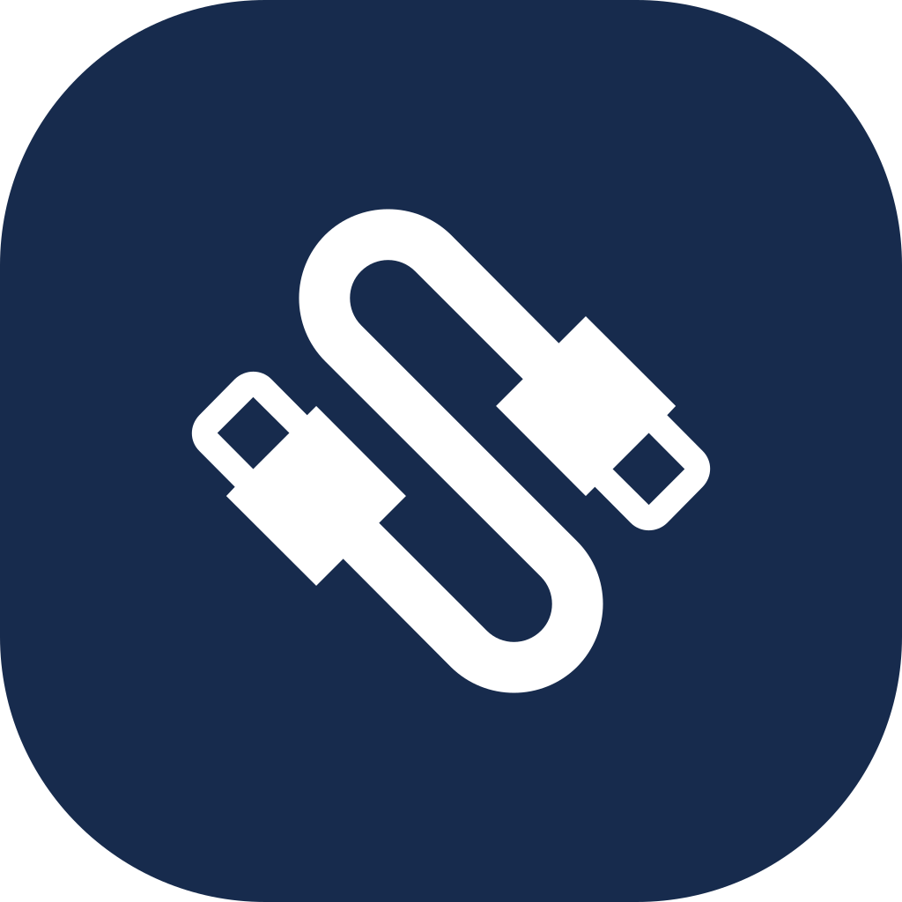

#  Wireframe — Cable & Conduit Schedules

Wireframe is a lightweight browser app for creating and managing electrical cable and conduit schedules, voltage drop calculations, conduit fill calculation, reviewing a bill of materials, and printing project reports.

## Features

- Create cable and conduit schedules, manage conduit assignments, and group parallel cable sets.
- Define reusable cable types, generate conductor/pair specifications, and manage equipment.
- Analyze NEC conduit fill, cable ampacity, and voltage drop.
- Track project details and cable lengths from the overview dashboard.
- Review the bill of materials, export schedules, the BOM, and voltage-drop reports as CSV, and print project reports.
- Choose a light, dark, or system-matched theme.

## Demo

Try the live web app: [https://eaconner.github.io/ConduitCableSchedule/](https://eaconner.github.io/ConduitCableSchedule/)

## Getting Started

1. Download or clone this repository and open `index.html` in a modern browser. No build or installation is required.
2. In **Settings**, enter project details, cable types, and equipment locations.
3. Create cable and conduit entries, assign cables to conduits, and enter the details needed for your analyses.
4. Use **Save** to download a `.ccs` backup and **Open** to restore a `.ccs` or `.json` file. Use **New** to start a blank project.
5. Use **Export** to create CSV files or print project reports.

Project data is stored in the browser. Save a backup to move it to another browser or device.

## License

This project is available under the [MIT License](LICENSE). You may use, modify, distribute, and include it in commercial products, provided the copyright and license notice is retained. See [LICENSE](LICENSE) for the full terms.
